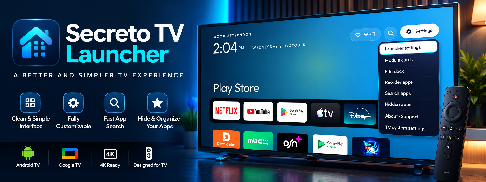
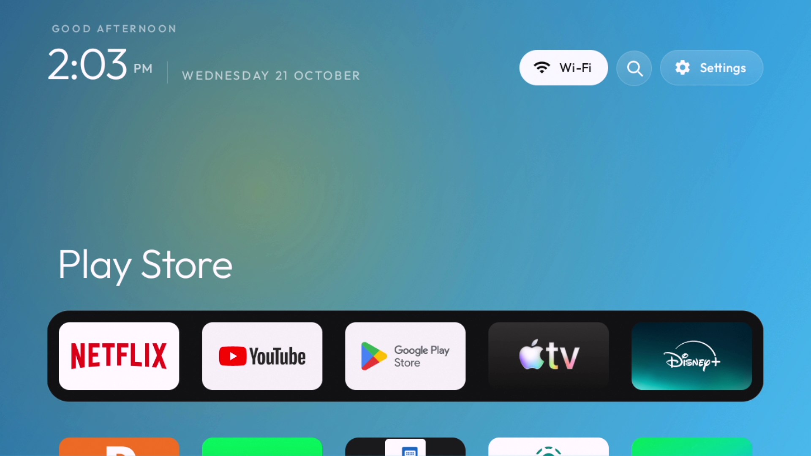
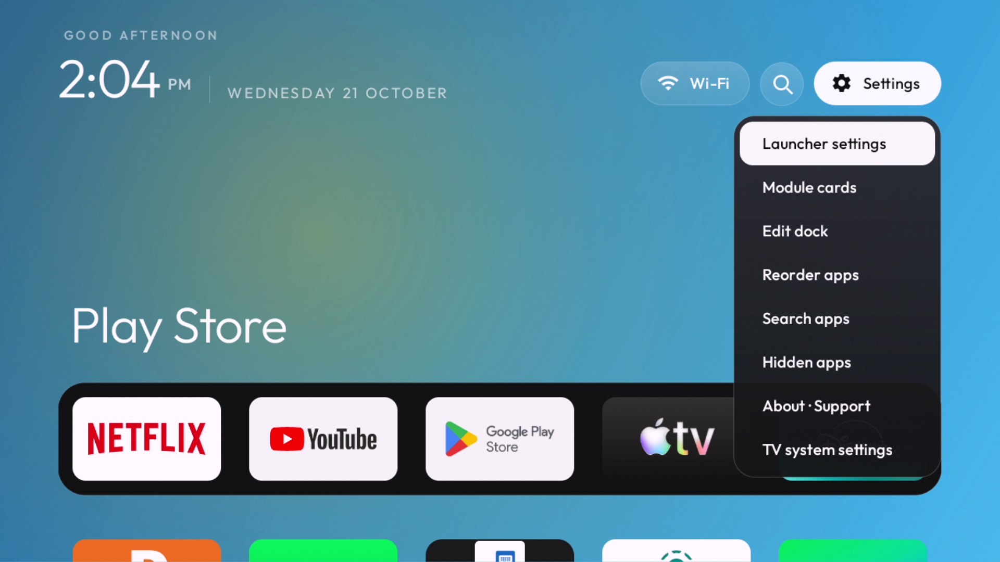
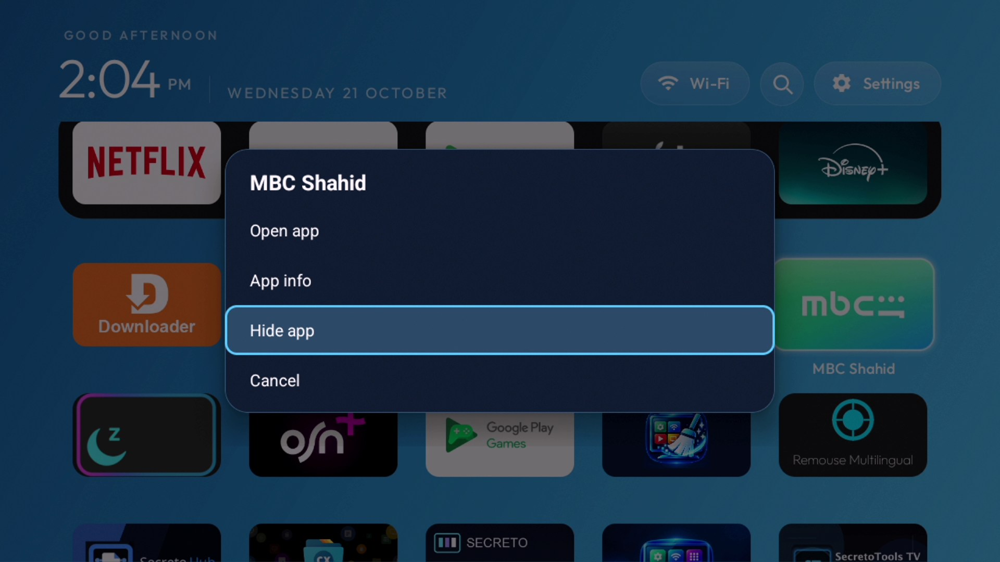

# Secreto TV Launcher

**A lightweight, remote-friendly home screen for Android TV and Google TV.**  
Developed and customized by **Mohamed LALAH** · **SecretoTools** · **SecretofNet**

**Latest stable release: v1.1.0** · Android TV / Google TV · Android 8.0+

[**⬇ Download signed APK v1.1.0**](https://github.com/mohamedlalah/SecretoTVLauncher/releases/download/v1.1.0/SecretoTVLauncher-v1.1.0-vc6.apk) · [Release notes](https://github.com/mohamedlalah/SecretoTVLauncher/releases/tag/v1.1.0) · [SHA-256 checksum](https://github.com/mohamedlalah/SecretoTVLauncher/releases/download/v1.1.0/SHA256SUMS.txt)

### Screenshots · صور التطبيق · Captures d’écran

| Home screen · الواجهة الرئيسية | Settings · الإعدادات |
|:--:|:--:|
|  |  |

**App management · إدارة التطبيقات · Gestion des applications**

## 🇬🇧 English

Secreto TV Launcher provides a clean, customizable TV home screen designed for use with a remote control.

**What's new in v1.1.0**
- Four built-in wallpapers: **Ocean Blue, Aurora, Glass, Moon Lake**
- Set one personal photo as a static wallpaper or create an automatically rotating slideshow
- Preview, manage and delete slideshow photos, with duplicate detection and prevention
- Home screen **Weather** and **Prayer Times** widgets
- Wallpaper dimming and optional widget visibility over personal photos
- D-pad-friendly controls and support for **19 interface languages**

**Other highlights:** Favorites, app organization and search, quick settings access, HDMI input shortcuts on supported Xiaomi TVs, and an About & Support page with YouTube Membership and GitHub Sponsors QR codes.

**Download:** [Signed APK v1.1.0](https://github.com/mohamedlalah/SecretoTVLauncher/releases/download/v1.1.0/SecretoTVLauncher-v1.1.0-vc6.apk) · [All releases](https://github.com/mohamedlalah/SecretoTVLauncher/releases). Requires Android 8.0+ (API 26+). Features and compatibility may vary by device.

**Install:** Download the APK, transfer it to your Android TV / Google TV device and install it using your preferred APK installer. If prompted, allow installation from that installer. Open Secreto TV Launcher and choose it as your Home app if your device supports changing the default launcher. Keep your original launcher available until you have tested everything.

## 🇲🇦 العربية

**Secreto TV Launcher** واجهة رئيسية خفيفة وقابلة للتخصيص لأجهزة Android TV وGoogle TV، مصممة للعمل بسهولة باستخدام جهاز التحكم عن بُعد.

**الجديد في الإصدار 1.1.0:** أربع خلفيات مدمجة (Ocean Blue وAurora وGlass وبحيرة القمر)، واختيار صورة شخصية ثابتة أو خلفية متغيرة تلقائياً، مع معاينة الصور وإدارتها ومنع التكرار. كما يتضمن أدوات الطقس ومواقيت الصلاة، وتعتيم الخلفية، والتحكم في إظهار الأدوات فوق الصور الشخصية، ودعم 19 لغة.

**مميزات أخرى:** المفضلة وتنظيم التطبيقات والبحث، واختصارات الإعدادات ومداخل HDMI على أجهزة Xiaomi المتوافقة، وصفحة دعم تحتوي على رمزي QR لعضوية SecretofNet ودعم GitHub Sponsors.

**التحميل:** [تنزيل APK الرسمي الموقّع v1.1.0](https://github.com/mohamedlalah/SecretoTVLauncher/releases/download/v1.1.0/SecretoTVLauncher-v1.1.0-vc6.apk) أو زيارة [جميع الإصدارات](https://github.com/mohamedlalah/SecretoTVLauncher/releases). يتطلب Android 8.0 أو أحدث، وقد تختلف بعض الميزات بحسب الجهاز.

**التثبيت:** حمّل ملف APK وانقله إلى التلفاز، ثم ثبّته باستخدام تطبيق تثبيت مناسب. افتح اللانشر وعيّنه كواجهة رئيسية إن كان جهازك يسمح بذلك. يُنصح بالإبقاء على الواجهة الأصلية حتى انتهاء التجربة.

## 🇫🇷 Français

**Secreto TV Launcher** est un écran d'accueil léger et personnalisable pour Android TV et Google TV, adapté à la télécommande.

**Nouveautés de la v1.1.0 :** quatre fonds d’écran intégrés (Ocean Blue, Aurora, Glass et Moon Lake), photo personnelle fixe ou diaporama automatique, gestion et détection des doublons, widgets météo et horaires de prière, assombrissement du fond et contrôle de l’affichage des widgets sur les photos. Interface disponible en 19 langues.

**Autres fonctions :** favoris, organisation et recherche des applications, raccourcis des paramètres, accès HDMI sur certains téléviseurs Xiaomi compatibles, et page de soutien avec QR codes YouTube et GitHub Sponsors.

**Téléchargement :** [APK signé v1.1.0](https://github.com/mohamedlalah/SecretoTVLauncher/releases/download/v1.1.0/SecretoTVLauncher-v1.1.0-vc6.apk) · [Toutes les versions](https://github.com/mohamedlalah/SecretoTVLauncher/releases). Android 8.0 minimum ; certaines fonctions dépendent de l’appareil.

**Installation :** transférez l'APK sur le téléviseur et installez-le avec un installateur adapté. Sélectionnez ce lanceur comme écran d'accueil si votre appareil le permet. Conservez le lanceur d'origine pendant les essais.

## ❤️ Support / الدعم / Soutien

The app is free; support is entirely optional.

- **YouTube Membership / عضوية القناة / Adhésion :** [Join SecretofNet](https://www.youtube.com/channel/UCLNy0tm-eDhKIlTSjh2VBGg/join)
- **GitHub Sponsors / دعم المطور / Parrainage :** [Sponsor Mohamed LALAH](https://github.com/sponsors/mohamedlalah)
- **Website:** https://secretotools.com

## Credits and licenses

This launcher is based on **[CleanYourTV by Gathin23](https://github.com/Gathin23/cleanyourtv)**, licensed under the **MIT License**. Original copyright: **Copyright (c) 2026 Gathin**.

The original MIT license, Outfit SIL OFL font license, applicable dependency notices, and built-in wallpaper artwork credits are included in the v1.1.0 APK. Wallpaper artwork credits: Gathin23 (Aurora), matheus-caldeira (Glass), and manas-04 (Moon Lake). The upstream MIT license applies to the upstream components; this repository distributes APK releases and documentation, not the modified source code.

**Publisher:** Mohamed LALAH · SecretoTools · SecretofNet

> **Disclaimer:** Not affiliated with Google, YouTube, Xiaomi, GitHub or other platform owners. Trademarks belong to their respective owners.
